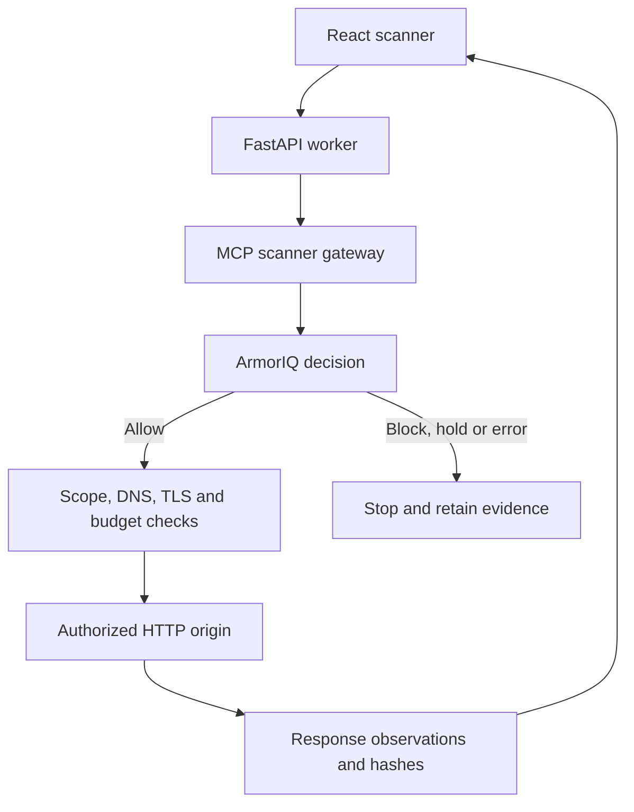
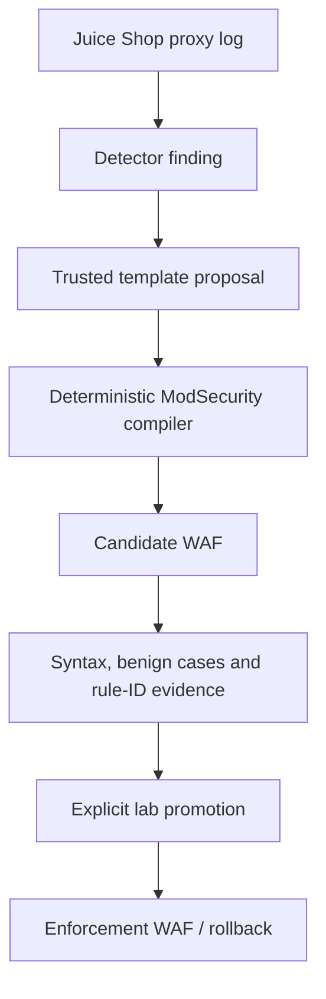

# Architecture and boundaries

The scanner's AI review receives a minimized summary after scanning; it cannot execute tools or change verdicts. Every request is evaluated separately. The readiness endpoint reports local prerequisites and historical outcomes, not authorization for a new request.

The rule compiler handles supported SQLi patterns on `GET /rest/products/search`, parameter `q`. It does not consume arbitrary scanner findings or generate rules from model text. Generating a proposal and compiled artifact can be automated through the API. Installing candidate content and promoting validated rules remain explicit operator actions.

The separate DevOps MCP service runs five constrained lab tools. A deterministic capability policy and optional semantic veto run before ArmorIQ. Decisions are recorded before execution; local deterministic denials may add exact-request deny fingerprints. This is a deny cache, not general policy learning. Shell tools run only the three allowlisted capabilities using a sanitized child environment.
